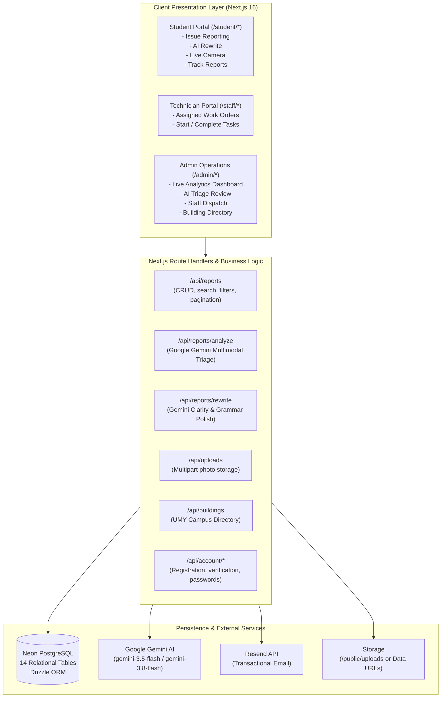
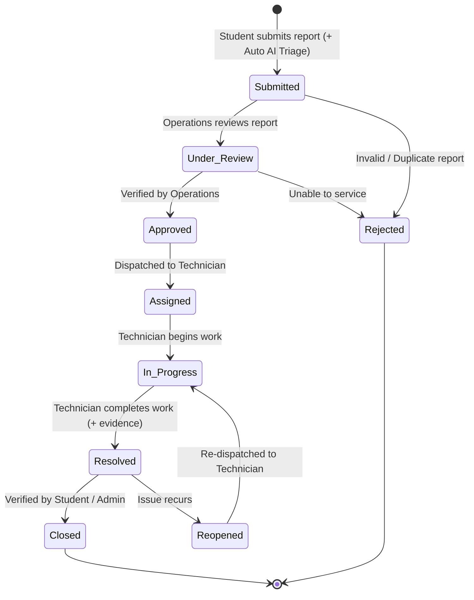
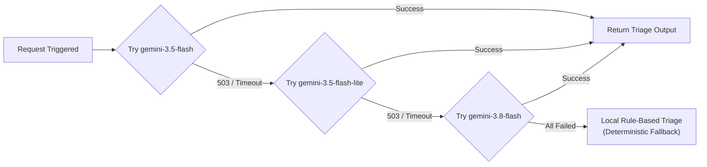
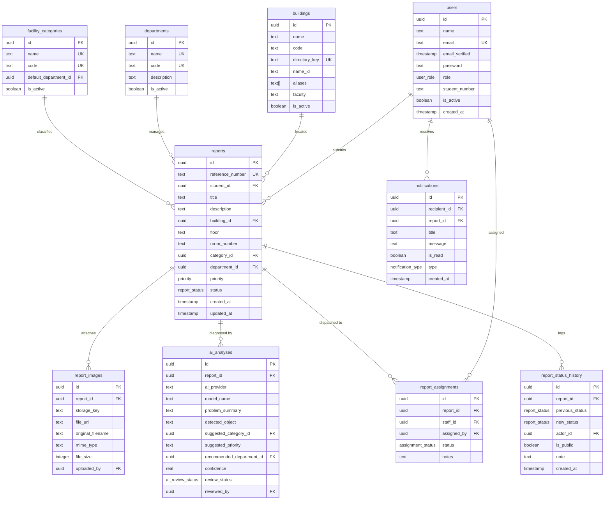

# CampusFix — Comprehensive Technical Project Documentation

**Project Name**: CampusFix (AI-Powered Campus Facility Maintenance System)  
**Academic Context**: Semester 5 University Project  
**Target Institution**: Universitas Muhammadiyah Yogyakarta (UMY)  
**Production URL**: [https://campus-fix-project-three.vercel.app](https://campus-fix-project-three.vercel.app)  
**GitHub Repository**: [https://github.com/mansoor9572/campus-fix-project](https://github.com/mansoor9572/campus-fix-project)  

---

## 1. Executive Summary

University campuses operate dozens of academic buildings, research laboratories, lecture halls, and administrative offices. Maintaining these facilities is essential to academic continuity and campus safety. Traditional reporting mechanisms—such as paper maintenance slips, phone calls, or fragmented messaging groups—suffer from several critical flaws:

1. **Slow reporting and triage**: Reports lack clear physical location information, preventing prompt dispatch.
2. **Ambiguous descriptions**: Students lack technical facility vocabulary, resulting in incorrect maintenance crew assignments.
3. **Lack of transparency**: Reporters rarely know whether an issue was acknowledged, assigned, or completed.
4. **No operational analytics**: Facility managers lack aggregated data on department workload, failure hotspots, or resolution speed.

**CampusFix** solves these challenges by combining **Next.js 16**, **PostgreSQL (Neon Serverless)**, **Auth.js v5**, and **Google Gemini AI**. The platform introduces:
* **Frictionless Student Reporting**: A single consolidated description field with an optional **"✨ Rewrite with AI"** tool to clarify wording without losing original facts.
* **In-Browser Camera & Mobile Capture**: Direct camera viewfinder and native smartphone capture for immediate photo evidence.
* **Automated Background AI Triage**: Multimodal Gemini analysis that evaluates both photos and text to identify fixtures, determine hazard priority, and suggest department dispatch.
* **Live Operations Management**: An administrative control center displaying real-time metrics, technician workload distribution, and one-click triage approval.

---

## 2. System Architecture & Workflows

### 2.1 High-Level Architecture Diagram



---

### 2.2 Report Lifecycle State Machine



---

## 3. Core Technical Modules

### 3.1 Google Gemini AI Multimodal Triage Engine

#### Architecture & Multi-Model Cascade
To guarantee high availability and eliminate downtime caused by model demand spikes (HTTP 503), the triage system implements a multi-model cascade with automated fallback:



#### Multimodal Input Processing
When a student uploads or snaps a photo, the image is passed along with the report title, description, and location to Google Gemini:

```typescript
const response = await ai.models.generateContent({
  model: "gemini-3.5-flash",
  contents: [
    `Campus Report to Triage:
     Title: ${input.title}
     Description: ${input.description}
     Building: ${input.building}
     Room/Location: ${input.room}`,
    {
      inlineData: {
        data: input.image.base64.replace(/^data:[^;]+;base64,/, ""),
        mimeType: input.image.mimeType || "image/jpeg",
      },
    },
  ],
  config: {
    systemInstruction: "You are an expert campus facilities engineer...",
    responseMimeType: "application/json",
    temperature: 0.2,
  },
})
```

#### Triage Output Schema
The AI returns a structured JSON payload:
* **`problemSummary`**: One concise sentence describing the failure.
* **`detectedObject`**: Specific physical fixture detected (e.g., *"Fluorescent tube and ballast"*, *"HVAC copper line"*).
* **`suggestedCategory`**: One of 11 valid campus facility categories.
* **`suggestedPriority`**: `low`, `medium`, or `high`.
* **`recommendedDepartment`**: Exact maintenance department to dispatch.
* **`confidence`**: Numeric score (0.0 to 1.0).

---

### 3.2 "✨ Rewrite with AI" (Reporter Text Polishing)

Students reporting an issue may be hurried, non-native speakers, or unsure how to articulate technical problems. The **Rewrite with AI** feature enables reporters to type naturally and request a polished revision.

#### Prompt Engineering Constraints
* **Factual Invariance**: The model is forbidden from inventing details, diagnosing causes, or altering urgency.
* **Preservation of Uncertainty**: Words like "might", "seems", or "intermittent" are strictly preserved.
* **JSON Integrity**: Returns strict `{ "text": "..." }` schemas bounded between 20 and 4,000 characters.
* **User Control**: The student previews the suggestion side-by-side and can choose **"Use this wording"**, **"Keep my wording"**, or **"Undo rewrite"**.

---

### 3.3 Media & Live Camera Capture Pipeline

CampusFix supports two complementary camera mechanisms:

1. **In-Browser WebRTC Camera Viewfinder**:
   * Uses `navigator.mediaDevices.getUserMedia({ video: { facingMode: "environment" } })`.
   * Displays live video preview with custom overlay controls.
   * Includes camera flip button (front vs. rear) and shutter button.
   * Renders the frame onto an offscreen `<canvas>` at full hardware resolution and produces a clean JPEG data URL.
2. **Native Mobile Device Camera (`capture="environment"`)**:
   * For smartphones, tapping "Take photo" activates the operating system's native camera application.
   * Utilizes hardware zoom, native flash, autofocus, and high-resolution sensor output.
3. **Storage Strategy**:
   * Primary: Persistent storage in `/public/uploads/` with unique UUID filenames.
   * Fallback: Self-contained base64 data URLs for read-only serverless environments.

---

### 3.4 UMY Campus Building Directory

The campus directory contains 27 pre-seeded university buildings for Universitas Muhammadiyah Yogyakarta:
* **Bilingual Search**: Supports Indonesian (e.g. *"Gedung Pascasarjana"*) and English (e.g. *"Faculty of Engineering"*).
* **Engineering Code Ranking**: Direct codes (e.g. `F1`, `F3`, `F6`) rank first in search results.
* **Fuzzy Alias Matching**: Handles common abbreviations, nicknames, and Indonesian spelling variations.

---

## 4. Database Design & Data Model

CampusFix uses **PostgreSQL** hosted on **Neon Serverless** with schema definitions managed by **Drizzle ORM** (`lib/db/schema.ts`).

### 4.1 Entity Relationship Diagram



---

## 5. Security Architecture & Access Control

### 5.1 Role-Based Access Control (RBAC) Matrix

| Endpoint / Action | Student | Maintenance Staff | Administrator |
|---|:---:|:---:|:---:|
| **Submit New Report** | ✅ Yes | ❌ No | ✅ Yes |
| **"Rewrite with AI"** | ✅ Yes | ❌ No | ✅ Yes |
| **View Own Reports & Timeline** | ✅ Yes | ❌ No | ✅ Yes |
| **View All Campus Reports** | ❌ No | ✅ Assigned Only | ✅ Yes |
| **Operations Live Dashboard** | ❌ No | ❌ No | ✅ Yes |
| **Assign / Reassign Staff** | ❌ No | ❌ No | ✅ Yes |
| **Approve / Correct AI Triage** | ❌ No | ❌ No | ✅ Yes |
| **Start Work (In Progress)** | ❌ No | ✅ Yes (Assigned) | ✅ Yes |
| **Mark Task Resolved** | ❌ No | ✅ Yes (Assigned) | ✅ Yes |
| **Manage Building Directory** | ❌ No | ❌ No | ✅ Yes |

### 5.2 Key Security Controls
1. **Password Protection**: Hashed using `bcryptjs` with salt rounds = 12. Minimum password length is enforced at 12 characters.
2. **Session Revocation**: JWT session claims verify user active status (`is_active = true`) and password version fingerprints on every sensitive query.
3. **Cross-Site Request Forgery (CSRF) Mitigation**: Custom origin verification matching canonical origin and reverse proxy headers (`x-forwarded-host`).
4. **Input Sanitation & Boundaries**: All user strings are bounded (`REPORT_TEXT_MIN = 20`, `REPORT_TEXT_MAX = 4000`, `LOCATION_LIMITS`). Null-byte injection (`\0`) is strictly rejected.
5. **Rate Limiting**: AI endpoints are rate-limited per user to prevent API quota exhaustion.

---

## 6. API Reference

### 6.1 Report Endpoints

#### `POST /api/reports`
Submits a new campus facility issue report. Triggers automatic background AI triage.
* **Authorization**: `student`, `admin`
* **Request Body**:
  ```json
  {
    "title": "Water dripping from AC in Room 302",
    "description": "The AC unit above desk 4 has been dripping water continuously since 9 AM.",
    "buildingId": "b1a2c3d4-...",
    "floor": "3rd Floor",
    "roomNumber": "F6.302",
    "categoryId": "c1d2e3f4-...",
    "priority": "medium",
    "images": [
      {
        "storageKey": "xyz.jpg",
        "fileUrl": "/uploads/xyz.jpg",
        "originalFilename": "ac-leak.jpg",
        "mimeType": "image/jpeg",
        "fileSize": 1048576
      }
    ]
  }
  ```
* **Response**: `201 Created` with full report record.

#### `GET /api/reports`
Lists paginated, server-filtered reports scoped to the user's role.
* **Query Parameters**: `page`, `pageSize`, `q`, `status`, `priority`, `buildingId`, `categoryId`, `days`, `sort`
* **Response**: `200 OK` `{ "reports": [...], "pagination": { "total": 45, "page": 1, "pageSize": 20 } }`

#### `GET /api/reports/:id`
Retrieves a single report with its status history, assigned staff, images, and AI analysis.
* **Authorization**: Report owner, assigned staff member, or administrator.

---

### 6.2 AI Endpoints

#### `POST /api/reports/rewrite`
Rewrites report text for grammar and clarity using Google Gemini.
* **Authorization**: `student`, `admin`
* **Request Body**: `{ "text": "air con dripping in room 201 floor is wet" }`
* **Response**: `{ "text": "Water is actively leaking from the air conditioning unit in Room 201, causing standing water on the floor." }`

#### `POST /api/reports/analyze`
Performs multimodal analysis on report text and attached image.
* **Request Body**: `{ "title": "...", "description": "...", "building": "...", "image": { "base64": "..." } }`
* **Response**: `{ "triage": { "detectedObject": "...", "suggestedCategory": "...", "suggestedPriority": "...", "confidence": 0.92 } }`

#### `PATCH /api/reports/:id/ai-analysis`
Allows administrators to approve, correct, or reject AI triage suggestions.
* **Authorization**: `admin`
* **Request Body**: `{ "action": "approved" }` (or `"corrected"`, `"rejected"`)

---

### 6.3 Media & Building Endpoints

#### `POST /api/uploads`
Accepts multipart image uploads (up to 5 MB).
* **Response**: `201 Created` `{ "id": "...", "storageKey": "...", "fileUrl": "..." }`

#### `GET /api/buildings`
Returns the 27 UMY university buildings for client-side search.

---

## 7. Testing & Quality Assurance

CampusFix includes **40 automated unit tests** across 5 test suites.

```bash
# Execute full test suite
npx tsx --test tests/auth.unit.test.ts tests/reports.unit.test.ts tests/ai.unit.test.ts tests/uploads.unit.test.ts tests/buildings.unit.test.ts
```

### Test Suite Summary

| Test Suite | Tests | Status | Scope |
|---|:---:|:---:|---|
| `tests/auth.unit.test.ts` | 7 | ✅ Passed | Password security, bcrypt preservation, role gates, Google linking |
| `tests/reports.unit.test.ts` | 13 | ✅ Passed | Input validation, optimistic locking, role transitions, status history |
| `tests/ai.unit.test.ts` | 8 | ✅ Passed | Gemini response parsing, multi-model failover, rule-based triage fallback |
| `tests/uploads.unit.test.ts` | 8 | ✅ Passed | 5 MB boundary, MIME whitelist, storage key validation |
| `tests/buildings.unit.test.ts` | 4 | ✅ Passed | 27 UMY entries, Indonesian/English search, alias matching |
| **Total** | **40** | **100% Pass** | |

### Static Analysis & Type Checking
* **TypeScript Compiler**: `npx tsc --noEmit` returns **0 errors** under strict mode.
* **ESLint**: 0 errors across all routes and components.

---

## 8. Deployment & Operational Runbook

CampusFix is hosted on **Vercel** with continuous deployment from GitHub:

* **Production URL**: `https://campus-fix-project-three.vercel.app`
* **Database**: Neon Serverless PostgreSQL (`us-east-2`) with connection pooling enabled.
* **DNS & SSL**: Automatic SSL certificates managed by Vercel Edge Network.
* **Environment Variables**:
  * `DATABASE_URL`: Pooled connection string (`?sslmode=require`).
  * `AUTH_SECRET`: Cryptographic secret for signing tokens.
  * `APP_URL`: Canonical HTTPS URL (`https://campus-fix-project-three.vercel.app`).
  * `AUTH_TRUST_HOST`: Set to `true` for reverse-proxy trust.
  * `GEMINI_API_KEY`: API key for Gemini Interactions.
  * `GEMINI_MODEL`: `gemini-3.5-flash` with automatic failover.
  * `RESEND_API_KEY`: Key for transactional email delivery.

---

## 9. Conclusion

CampusFix demonstrates how modern web engineering and artificial intelligence can transform university facility operations. By eliminating reporting friction for students, providing instant visual capture through live camera integration, and automating technical triage with Google Gemini, the platform significantly accelerates response times, prevents hazardous facility conditions, and provides university leadership with actionable operational intelligence.
